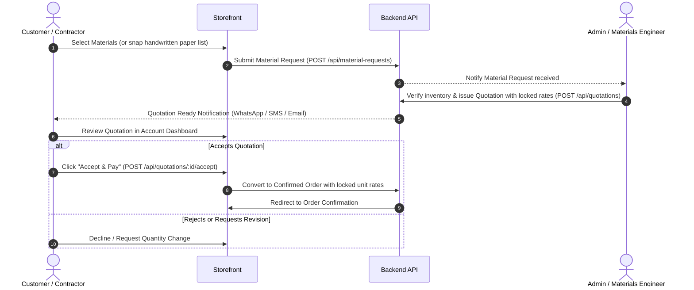
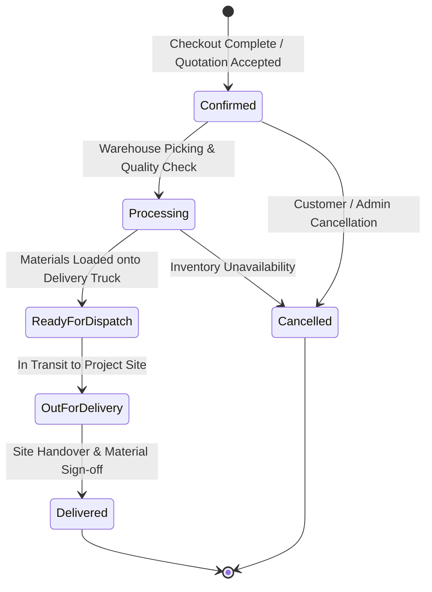

# BuildMart — Industrial Construction Materials E-Commerce Platform

A production-grade, enterprise-ready construction materials and building supplies e-commerce platform built for builders, contractors, developers, and homeowners.

---

## 🏗️ Architecture Overview

```mermaid
graph TD
  User([Contractor / Customer]) -->|HTTPS| Web[Frontend SPA / PWA (Vite + React)]
  Admin([Store Administrator]) -->|HTTPS| Web
  Web -->|REST API / JSON| API[Backend API (Node.js + Express)]
  
  subgraph Backend Tier
    API --> Auth[RBAC & Auth Guard]
    API --> Pricing[Deterministic Pricing Engine]
    API --> Orders[Atomic Order State Machine]
    API --> SEO[Dynamic Sitemap & Robots]
    API --> Jobs[Background Worker Queue]
  end

  subgraph Data Tier
    API --> Mongo[(MongoDB Replica Set)]
    API --> Redis[(Redis Cache & Queues)]
    Jobs --> Mongo
    Jobs --> Redis
  end

  subgraph External Services
    API --> Razorpay[Razorpay Payment Gateway]
    API --> Cloudinary[Cloudinary Media CDN]
    Jobs --> SMTP[SMTP / Nodemailer Mailer]
  end
```

---

## ⚡ Core Business Workflows

### 1. Quotation & Material Estimation Lifecycle



### 2. Confirmed Order Fulfillment & Tax Invoicing


---

## 🔐 Role-Based Access Matrix

| Role | Catalog Browsing & Cart | Place Orders & Track | Quotations Management | Product Catalog CRUD | User Management | System Settings |
| :--- | :---: | :---: | :---: | :---: | :---: | :---: |
| **Guest / Anonymous** | ✅ | ❌ (Prompts Login) | ❌ | ❌ | ❌ | ❌ |
| **Customer** | ✅ | ✅ | ✅ (Own quotes) | ❌ | ❌ | ❌ |
| **Support Staff** | ✅ | ✅ (Read-only) | ✅ (Read-only) | ❌ | ❌ (View notes) | ❌ |
| **Operations Manager**| ✅ | ✅ | ✅ (Issue quotes) | ✅ | ❌ | ❌ |
| **Administrator** | ✅ | ✅ | ✅ | ✅ | ✅ | ✅ |

---

## 🚀 Quick Start Guide

### Option 1: Docker Compose (Zero Configuration)

Bring up the complete production-identical stack (MongoDB replica set, Redis, Node API, Worker, and Nginx frontend) with one command:

```bash
# 1. Clone repository
git clone https://github.com/your-org/build-mart.git
cd build-mart

# 2. Launch containerized cluster
docker compose up -d --build

# 3. Access web applications
# Storefront: http://localhost
# API Health: http://localhost:5000/api/health
# OpenAPI Docs: http://localhost:5000/api/docs
```

---

### Option 2: Local Developer Setup (Zero-Config In-Memory Database)

The backend features an automated in-memory MongoDB engine (`mongodb-memory-server`). When `MONGODB_URI` is omitted in development, the engine spawns seamlessly without needing a local MongoDB daemon installed.

#### 1. Install Dependencies
```bash
npm install --prefix backend
npm install --prefix frontend
```

#### 2. Seed Database
```bash
npm run seed
```
*Seeds 30 high-volume construction materials across 8 categories (UltraTech, Tata Tiscon, Astral, Dr. Fixit, Jaquar), demo coupons (`BUILD10`), and admin accounts (`admin@buildmart.in` / `Admin@123456`).*

#### 3. Start Development Servers
Run the backend API and frontend Vite servers concurrently:
```bash
# Terminal 1: Backend API (Port 5000)
npm run backend:dev

# Terminal 2: Frontend Client (Port 5173)
npm run frontend
```

Storefront will be running at `http://localhost:5173`.

---

## 🧪 Testing & Verification

The platform includes 26 automated unit, regression, and integration tests covering:
- Zero Client Price Trust & GST calculation (Intra-state CGST/SGST vs Inter-state IGST).
- Gap-free sequential invoice/order counter generators.
- Atomic stock reservations and race condition handling.
- Locked quotation rate overrides.
- Account recovery tokens with SHA-256 one-time hashing.
- Review spam prevention and rating denormalization.
- Wishlist uniqueness per user.
- Delivery serviceability pincode lookup.
- Streaming PDF tax invoice generation.
- Dynamic `sitemap.xml` and `robots.txt` crawler routing.
- Cart live inventory validation and guest cart merge on login.

Run the full automated test suite:
```bash
npm test --prefix backend
```

Run frontend production build verification (with code-splitting and bundle budgets):
```bash
npm run build --prefix frontend
```

---

## 📁 Repository Structure

```
build-mart/
├── .github/
│   ├── workflows/ci.yml       # GitHub Actions CI workflow
│   └── dependabot.yml         # Automated dependency vulnerability updates
├── backend/
│   ├── src/
│   │   ├── config/            # Database & environment configurations
│   │   ├── constants/         # Order, enquiry, and system enums
│   │   ├── controllers/       # Business logic controllers
│   │   ├── jobs/              # Background queue workers (sweepers & stock releases)
│   │   ├── middleware/        # JWT auth, validation, uploads, rate limiters
│   │   ├── models/            # Mongoose ODM schemas & compound indexes
│   │   ├── routes/            # Express router declarations
│   │   ├── scripts/           # Migration runners, admin bootstrap, load test seeders
│   │   ├── services/          # Pricing engine, PDF invoice streamer, cache wrapper
│   │   └── utils/             # State machine, logger, counters, async helpers
│   ├── tests/                 # Automated Node.js test suites
│   ├── Dockerfile             # Multi-stage production container
│   └── package.json
├── frontend/
│   ├── public/                # Favicon, PWA manifest, fallback SVG placeholders
│   ├── src/
│   │   ├── components/        # Reusable UI components, modals, and admin DataTable
│   │   ├── context/           # Auth, Cart, Wishlist, Settings, Notifications contexts
│   │   ├── pages/             # Lazy-loaded storefront and admin pages
│   │   └── utils/             # Axios instance, token refresh queue, formatters
│   ├── nginx.conf             # Production Nginx reverse proxy configuration
│   ├── Dockerfile             # Production static SPA container
│   └── vite.config.js         # Rollup manualChunks & code-splitting configuration
├── docs/                      # Technical reports, OpenAPI specs & deployment runbooks
├── docker-compose.yml         # Production multi-container orchestration
├── docker-compose.dev.yml     # Hot-reloading development orchestration
├── SECURITY.md                # Vulnerability disclosure & defense-in-depth policy
└── README.md
```

---

## 📜 Available NPM Scripts

| Command | Scope | Description |
| :--- | :--- | :--- |
| `npm run seed` | Root | Seeds 30 products, brands, categories, coupons, and admin account |
| `npm run build` | Root / Frontend | Compiles production frontend bundle with Rollup code-splitting |
| `npm test --prefix backend` | Backend | Executes all 26 automated unit and integration tests |
| `npm run migrate --prefix backend` | Backend | Runs database migrations (supports `--dry-run`) |
| `npm run worker --prefix backend` | Backend | Starts standing background job worker |
| `npm run seed:load --prefix backend`| Backend | Seeds 10,000 products & 50,000 orders for load benchmarking |

---

## 📄 License & Support

Proprietary software — Built for BuildMart Technologies Pvt Ltd.  
For technical support or inquiries, email `orders@buildmart.in`.
